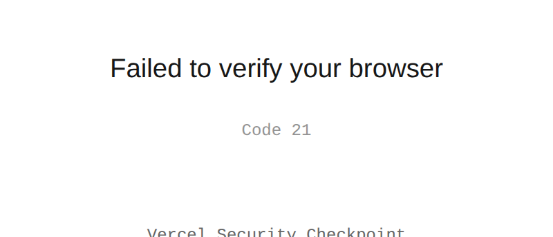

  <h1>⚡ André Antonio da Silva Queiroz</h1>
  
<strong>Product Manager & Software Engineer | Bridging Business Strategy with High-Speed MVP Execution</strong>

  
<em>"Code is useless if it doesn't solve a real human pain point."</em>

  
  

    

  

    

  🏢 **Computer Engineering Undergraduate @ UTFPR (Class of 2027)** | 🚀 **Founder @ Focus Shark** | 🛡️ **President @ CyberGuard**

