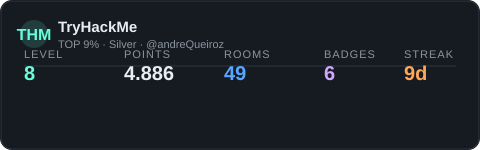

  <h1>⚡ André Antonio da Silva Queiroz</h1>
  
<strong>Product Manager & Software Engineer | Bridging Business Strategy with High-Speed MVP Execution</strong>

  
<em>"Code is useless if it doesn't solve a real human pain point."</em>

   

  
  
  

    

  <h3>🛠️ DevTools Enabler — a extensão com mais usuários do meu portfólio</h3>
  

    Extensão <strong>Manifest V3</strong> reativa e ultraleve que impede sites de bloquear
    DevTools (F12), menu de contexto e seleção de texto.
    Publicada em <strong>3 lojas de navegadores</strong> com centenas de instalações ativas.
    <a href="https://github.com/777SevenSeven/Chromium">[código-fonte]</a>
  

  

    

  🏢 **Computer Engineering Undergraduate @ UTFPR (Class of 2027)** | 🚀 **Founder @ DevTools Enabler** | 🛡️ **President @ CyberGuard**

---

## 🚀 01. Produto Real com Tração

| Produto | Problema resolvido | Evidência |
| :--- | :--- | :--- |
| 🛠️ **[DevTools Enabler](https://chromewebstore.google.com/detail/devtools-enabler/pbnlbadpeblgajhidiopfbfpmkegamfh)** | Sites bloqueiam F12, clique direito e seleção de texto — a extensão restaura tudo com um clique, 100% local e sem coleta de dados | Chrome Web Store · Edge Add-ons · Firefox Add-ons · [source](https://github.com/777SevenSeven/Chromium) |
| 🛡️ **CyberGuard UTFPR** | Liderança da iniciativa estudantil de segurança da informação: treinamentos, conscientização e governança de AppSec | Liderança técnica & organizacional |

---

## 🧩 02. Projetos Selecionados

<!-- AUTO:PROJECTS:START -->

### 🧩 Projetos em destaque

Seção gerada automaticamente por GitHub Actions — analisa descrição, README, stack e atividade dos repositórios públicos.

| Projeto | O que é | Stack |
| :--- | :--- | :--- |
| [RPG-Game-Dragon-Killer](https://github.com/777SevenSeven/RPG-Game-Dragon-Killer) ⭐1 | RPG - Dragon Killer. Jogo de RPG desenvolvido em HTML, CSS e JavaScript, utilizando o framework Electron para criar uma aplicação desktop multiplataforma. | `JavaScript` |
| [F.old](https://github.com/777SevenSeven/F.old) | An autonomous agent that reads seller descriptions to filter junk, calculates real logistics costs, and finds high-ROI resale deals 24/7. | `Dart` |
| [ai-assisted-code-modernization](https://github.com/777SevenSeven/ai-assisted-code-modernization) | AI-assisted modernization of a legacy Python codebase with debugging, testing, code review, and automated validation. | `Python` |
| [Prototipo-Hackasun](https://github.com/777SevenSeven/Prototipo-Hackasun) | Plataforma de incentivo e capacitações para competições do Hackathon e principalmente com o pensamento sustentável. | `HTML` |
| [BichoFeliz-PetShop](https://github.com/777SevenSeven/BichoFeliz-PetShop) | Site de PetShop responsivo, feito com HTML, SASS e JS | `SCSS` |
| [Brazil-Properties](https://github.com/777SevenSeven/Brazil-Properties) | Um site de realstate feito com HTML, CSS(Bulma CSS) e Javascript(Jquery) e outros addons. | `HTML` |

Labels e seleção são automáticas: repos de soluções de juízes, forks e arquivos de estudo são filtrados pelo score de utilidade.

<!-- AUTO:PROJECTS:END -->

---

## ⚡ 03. Algoritmos & Proficiência em Engenharia

Consistência diária comprovada na resolução de problemas complexos e modelagem de dados.

| Track | Resultado |
| :--- | :--- |
| ⚡ **[LeetCode](https://github.com/777SevenSeven/Leetcode-Solutions)** | 🏆 SQL 50: 100% completo · 49+ soluções documentadas com complexidade Big-O |
| 🐝 **[Beecrowd](https://github.com/777SevenSeven/Beecrowd-Resolutions)** | 🎯 626+ submissões aceitas em 382 problemas únicos (dificuldade 1 a 9) |

---

## 🛡️ 04. Cibersegurança Prática & Laboratórios

Hands-on em ambientes reais de teste — do laboratório de malware em Python ao pentest em Metasploitable 2.

- 🔬 [dio-malware-simulation-python](https://github.com/777SevenSeven/dio-malware-simulation-python) — simulação de Trojan/Keylogger com exfiltração via Telegram e análise de defesas
- 🎯 [dio-smb-credential-exploit](https://github.com/777SevenSeven/dio-smb-credential-exploit) — ciclo de invasão (recon + exploração) em ambiente controlado
- 🏅 Cisco CyberEducation Scholar · TryHackMe badge acima (atualizado diariamente)

---

## 📊 05. GitHub Activity & Métricas

  
  

